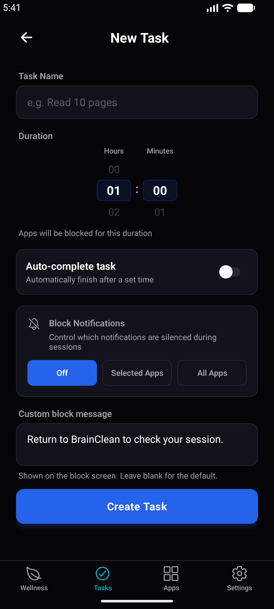
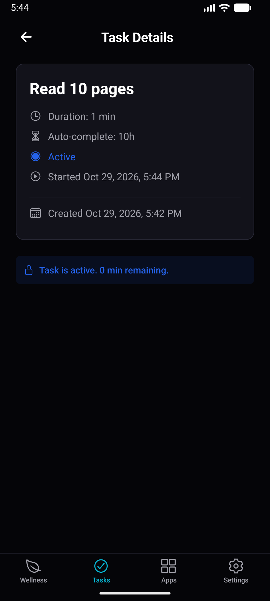
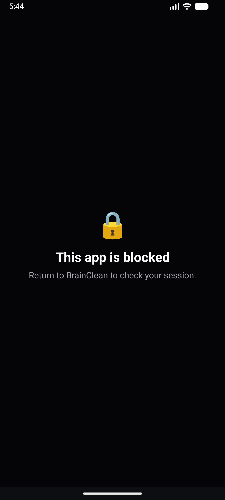
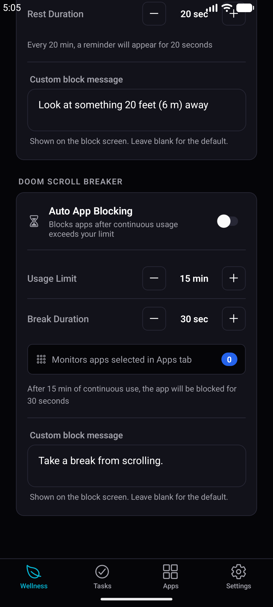

# BrainClean

**Finish the task first, then get your apps back.**

BrainClean is an Android app for digital wellness. You create a task, such as "Read 10 pages", pick the apps that distract you, and start it. Those apps stay blocked until the task's minimum time has passed and you mark it done. Blocking keeps running if you force-close the app or reboot the phone.

The app works fully offline. It has no accounts, no backend, no analytics and no network requests. Everything stays on the device.

<p>
  <a href="https://play.google.com/store/apps/details?id=com.brainclean.app"></a>
  <a href="https://chromewebstore.google.com/detail/brainclean-focus-tasks-si/jdlhflckkkabcgohfnpbmgkpedcapfng"></a>
</p>

> **There's also a browser extension.** [BrainClean for Chrome](https://chromewebstore.google.com/detail/brainclean-focus-tasks-si/jdlhflckkkabcgohfnpbmgkpedcapfng) brings the same focus tasks, eye-care breaks and doom-scroll breaker to the desktop by blocking websites instead of apps.


<p align="center">
  
  
  
  
</p>

---

## Features

- **Task-gated blocking.** Pick apps, start a task, and they stay locked until you finish it. You can set a minimum duration, and an optional maximum ends the session automatically.
- **Survives being killed.** Blocking runs in a Kotlin foreground service that keeps going after the app is force-closed, after a reboot and while the phone is in Doze mode.
- **Can't be beaten by changing the clock.** Durations use `SystemClock.elapsedRealtime`, so changing the device time doesn't end a session early.
- **Notification blocking.** For each task you can silence notifications from blocked apps only, from all apps, or from none.
- **Wellness tools.**
  - **Eye-care breaks:** a full-screen countdown reminds you to look away from the screen on an interval you set.
  - **Auto-block:** apps are locked automatically after a daily usage limit.
- **Private by design.** No accounts and no network calls. Blocking state stays in on-device storage and is excluded from Android backup.
- **15 languages**, including Arabic and Urdu (right-to-left), Chinese, Japanese, Korean and Hindi.
- **Dark and light themes**, plus a built-in tutorial and walkthrough.
- **Fixes for aggressive OEM skins.** On Xiaomi, Transsion, Oppo, Vivo, Huawei and Samsung phones, the app detects the brand and guides you to stop the system from killing it.

## Architecture

The main design decision is that **React Native is the remote control and Kotlin is the engine.**

```
┌─────────────────────────────┐        ┌──────────────────────────────────────┐
│  React Native / Expo (UI)   │        │  Kotlin native layer (enforcement)   │
│                             │ bridge │                                      │
│  • Task list (Zustand +     │ ─────▶ │  BlockerService  (foreground svc)    │
│    AsyncStorage)            │        │   ├─ AppMonitor   UsageStats @250ms  │
│  • Preferences, i18n, theme │ ◀───── │   ├─ BlockerOverlay  system window   │
│  • Expo Router screens      │ events │   └─ NotificationBlockerService      │
│                             │        │  BlockerState  (SharedPreferences)   │
│  Dies on force-close        │        │  BootReceiver · ServiceGuardReceiver │
└─────────────────────────────┘        │  WellnessService                     │
                                       │  Survives app kill & reboot          │
                                       └──────────────────────────────────────┘
```

- **Kotlin makes every enforcement decision.** `stopBlocking()` refuses to end a session before the minimum duration. The service ends it by itself when the maximum is reached. None of this logic lives in JavaScript, which can be killed or bypassed.
- **Blocking state lives in SharedPreferences, not JS.** `BlockerState` is the single source of truth. On boot, `BootReceiver` reads it and restarts the service without React Native.
- **Keep-alive in layers.** `START_STICKY`, a partial wake lock, and `ServiceGuardReceiver`, an alarm that fires during Doze every ~2 minutes and relaunches the service if the OS killed it.
- **Reconciliation.** The JS task list is history, not enforcement. If the app was dead when a session ended, `reconcile()` brings the records back in line with what Kotlin did.
- **A small, explicit bridge** built with the Expo Modules API ([`modules/blocker`](modules/blocker)).
- **No AccessibilityService.** Detection uses `UsageStatsManager` polling, which avoids the Play Store policy risk of using accessibility APIs for blocking.

## Tech stack

| Layer            | Tools                                                                     |
| ---------------- | ------------------------------------------------------------------------- |
| UI               | React Native 0.81, React 19 (React Compiler), Expo SDK 54, Expo Router    |
| State            | Zustand (persisted to AsyncStorage)                                       |
| Validation       | Zod                                                                       |
| i18n             | i18next / react-i18next (15 locales)                                      |
| Native           | Kotlin, Expo Modules API, foreground services, `UsageStatsManager`, `NotificationListenerService`, `AlarmManager` |
| Language & build | TypeScript (strict), EAS Build, custom dev client, Expo config plugins     |

## Project structure

```
app/                 Expo Router screens: (setup) permissions wizard, (main) tabs
components/          Reusable UI components
hooks/               useBlocker, useTasks, useWellness, usePermissions, ...
store/               Zustand stores: tasks, UI preferences
modules/blocker/     Native module: TS bridge + Kotlin services
i18n/locales/        15 translation files
plugins/             Expo config plugins (manifest, backup rules)
legal/               Privacy policy and terms
```

## Getting started

> Android only. Expo Go is **not** supported because the app ships a custom native module, so you need a development build.

**Prerequisites:** Node.js 20+, JDK 17, Android SDK, and a device or emulator running Android 7.0+ (API 24).

```bash
npm install
npm run android        # builds the custom dev client and installs it
npm start              # starts Metro for later sessions
```

Useful commands:

```bash
npx tsc --noEmit       # type-check
npx expo lint          # lint
```

On first launch the setup wizard asks for **Usage Access**, **Display over other apps** and a **battery optimization exemption**. All three are required for blocking to work.

## The BrainClean family

| Product        | Platform | Get it                                                                                                                  |
| -------------- | -------- | ----------------------------------------------------------------------------------------------------------------------- |
| BrainClean     | Android  | [Google Play](https://play.google.com/store/apps/details?id=com.brainclean.app)                                         |
| BrainClean Web | Chrome   | [Chrome Web Store](https://chromewebstore.google.com/detail/brainclean-focus-tasks-si/jdlhflckkkabcgohfnpbmgkpedcapfng) |

## Privacy

BrainClean makes no network requests. Tasks, preferences and blocking state stay on the device. See [`legal/privacy.html`](legal/privacy.html).

## License

[MIT](LICENSE) © 2026 Rehan
